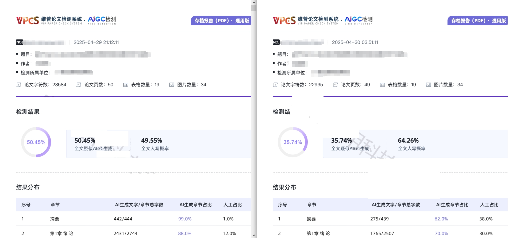
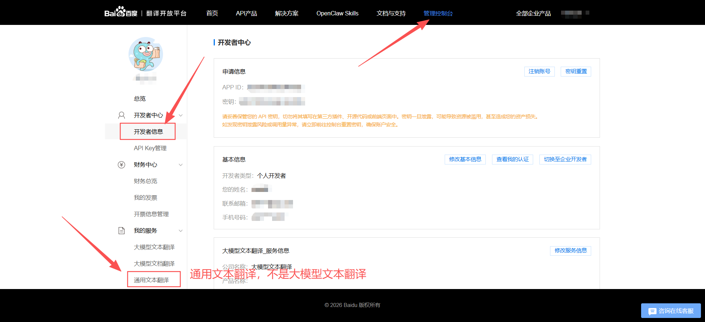

# 文章降重助手

一个基于百度翻译API的智能文章论文降重工具，通过多语言转换实现文本论文降重与AIGC降重，支持多种降重模式。


## 效果显示

维普AIGC检测


维普文章检测


## 功能特点

- 🎯 智能降重：通过多语言转换实现文本降重
- 📄 分段支持：粘贴时保留换行，段落结构原样输出
- 📊 实时统计：显示字符数和词数统计
- 🔍 文本对比：按句比对，差异处标到字，删除内容带删除线
- 📝 格式保持：正文用宋体、两端对齐、首行缩进随字号自适应
- ✔ 多种模式：提供初级、中级、高级三种降重模式
- 📋 一键操作：支持一键复制和粘贴
- 📈 进度显示：按「段落 / 请求」显示真实进度
- ⏹ 可中断：降重过程中随时取消
- 💯 改动率计算：显示改动率、保留率与字数变化
- 💾 配置持久化：配置存到用户目录，重启自动加载
- 🔐 密钥保护：APPKEY 存入系统凭据管理器或 DPAPI 加密
- 🧮 额度预估：开始前预估请求数与字符消耗

## 安装说明

1. 确保已安装 Python 3.9 或更高版本

2. 安装所需依赖：

   ```bash
   pip install -r requirements.txt
   ```

   `rapidfuzz` 与 `keyring` 为可选依赖，缺失时程序会自动降级，不影响运行。

3. 启动：

   ```bash
   python main.py
   ```

## 使用说明

### 1. API配置

- 访问[百度翻译开放平台](https://fanyi-api.baidu.com/)注册账号
- 1、登录后进入管理控制台（首次用户）
- 2、注册成为百度翻译开发者（选择个人）
- 3、进入管理控制台即可看到APPID和APPKEY
- 4、立即开通-通用文本翻译-标准版-提交申请
- 5、在软件中填写 API 信息并「保存配置」

配置说明：

- 配置保存在用户目录（Windows 为 `%APPDATA%\ArticleReducer\`），不再放在程序目录
- APPKEY 不会明文落盘：优先存入系统凭据管理器，其次是 Windows DPAPI 加密
- 从旧版本升级时，程序会自动迁移原来的 `config.json`，并把原文件改名为 `.bak`
- 启动时即加载配置，**无需先点「测试连接」**；该按钮只用于验证凭证是否可用



### 2. 降重操作

1. 在「原文输入」框中输入或粘贴需要降重的文章，**可以用换行分段，段落结构会被保留**
2. 选择降重模式：
   - 初级：中 -> 英 -> 德 -> 中
   - 中级：中 -> 英 -> 德 -> 日 -> 葡萄牙 -> 中
   - 高级：中 -> 英 -> 德 -> 日 -> 葡萄牙 -> 意大利 -> 波兰 -> 保加利亚 -> 爱沙尼亚 -> 中
3. 点击「开始降重」，等待处理完成；中途可以点「取消」中止
4. 查看结果与「改动率」，切换到「对比」页看差异
5. 使用「一键复制」获取降重后的文本

### 3. 文本对比

- 切换到「对比」标签页
- 按句比对，差异处精确定位到字
- 红色背景 + 删除线表示被删掉的内容
- 绿色背景表示新增的内容

## 技术特点

- 使用 PyQt5 构建界面，业务逻辑与界面分层：`app/core` 为纯 Python，零 Qt 依赖
- 采用百度翻译API进行多语言转换，请求走 HTTPS、`Session` 复用连接
- 按 **UTF-8 字节**（而非字符）分段，兼容中英日等多语言断句，单句超长时自动硬切
- 每跳翻译后重新分段，避免译文变长导致请求超限
- 网络异常指数退避重试，命中限流（54003）后自动降速
- 后台线程执行任务，界面不阻塞，支持取消
- 使用 `rapidfuzz` 计算编辑距离，长文本秒级完成
- 配置持久化 + 密钥加密存储
- 统一的异常体系，失败即抛出，不靠字符串匹配判断

## 注意事项

1. API配置说明：

   - 配置保存在用户目录，密钥走系统凭据管理器 / DPAPI
   - 首次使用需要配置百度翻译API信息
   - 如需更换API账号，重新填写并保存即可

2. API使用量限制：

   - 标准版：每月免费5万字符
   - 高级版：每月免费100万字符（需实名认证）

3. 额度消耗估算：

   - 每跳都会重新翻译全文，消耗额度约为「正文字数 × 跳数」
   - 初级 3 跳，一篇 3000 字的文章约消耗 9000 字符
   - 高级 9 跳，同样的文章约消耗 27000 字符
   - 界面会在开始前给出预估，超过 4 万字符时会二次确认

4. 使用建议：

   - 建议先使用初级模式测试效果
   - 「改动率」越高表示文本改动越大

## 指标说明

界面上的「改动率 / 保留率」是本地按编辑距离算出的**文本改动比例**，用于衡量改写幅度。

**它不是知网、维普的查重结果**，也不能替代查重报告——真正的重复率只能在检测平台跑。

## 降重原理

软件通过在不同语言之间进行多次转换，利用不同语言的语序和表达方式差异，实现文本降重。每次转换都会改变文本的表达方式，最终回到中文时会产生新的表达方式，从而达到降重的目的。

## 常见问题

1. Q: 为什么需要配置API？
   A: 软件使用百度翻译API进行文本转换，需要有效的API密钥才能使用。

2. Q: API配置会保存吗？
   A: 会。配置保存在用户目录，重启自动加载。旧版的 `config.json` 会被自动迁移。

3. Q: 降重效果如何？
   A: 降重效果取决于原文内容和选择的模式。一般来说，高级模式的降重效果更好，但字符额度消耗更多。

4. Q: 支持哪些文件格式？
   A: 目前直接读写文本，复制到 Word 中可保持格式。文件导入导出计划在后续版本提供。

5. Q: 为什么长文也能过了？
   A: 旧版按「字符」判断长度，而百度接口限制是 6000 字节（约 2000 汉字）；现在改为按字节分段，超长单句会自动硬切。

6. Q: APPKEY 存在哪里？
   A: 优先存进系统凭据管理器（`pip install keyring`）。没有 keyring 时使用 Windows DPAPI 加密，绑定当前用户账户。

## 更新日志

### v2.0.0

本次为重构版本，界面与功能均有变化：

- 修复：重启后必须点「测试连接」才能降重的问题（配置未注入）
- 修复：长度按字符而非字节计算，导致 2000 字以上必然报错
- 修复：断句只认中文句号，中/高级模式对长文不可用
- 修复：正文含「错误」「失败」等词时被误判为翻译失败
- 修复：主线程阻塞导致界面假死，现改为后台线程并支持取消
- 修复：对比视图对单段落文本失效
- 修复：首行缩进写死 24 像素，换字号错位
- 安全：接口改用 HTTPS，参数改为表单提交，不再把密钥放进 URL
- 安全：APPKEY 加密存储，配置移出程序目录
- 性能：编辑距离改用 rapidfuzz，长文本从数十秒降到毫秒级
- 性能：复用 HTTP 连接，指数退避重试，限流自动降速
- 新增：分段支持、额度预估、超量确认、进度明细
- 变更：「降重率」更名为「改动率 / 保留率」，并注明不等于查重率
- 架构：拆分为 `app/core`、`app/infra`、`app/ui` 三层

### v1.2.0

- 增加严格的API凭证验证机制
- 改进API连接测试功能
- 优化错误提示信息
- 增强API安全性检查

### v1.1.0

- 添加配置持久化功能
- 优化API配置界面
- 改进错误提示信息

### v1.0.0

- 初始版本发布
- 支持三种降重模式
- 实现文本对比功能
- 添加字数统计
- 支持格式保持
