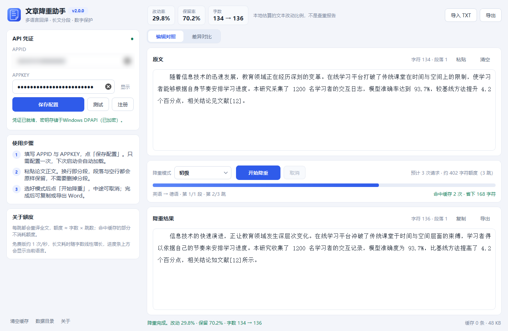
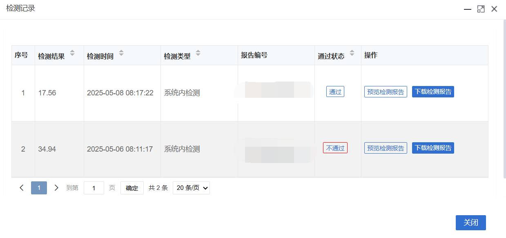
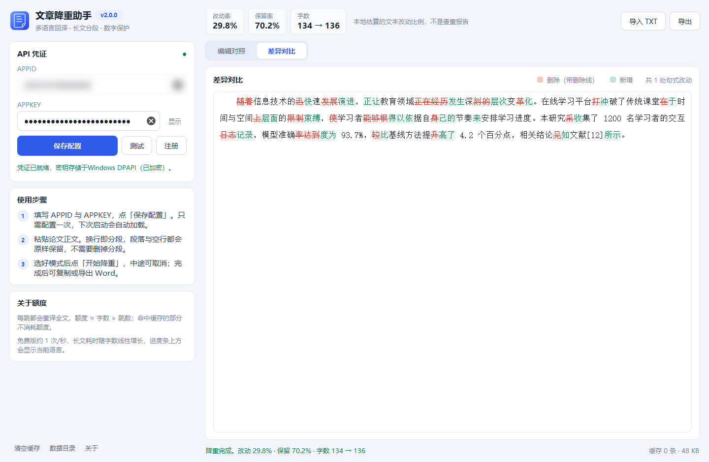
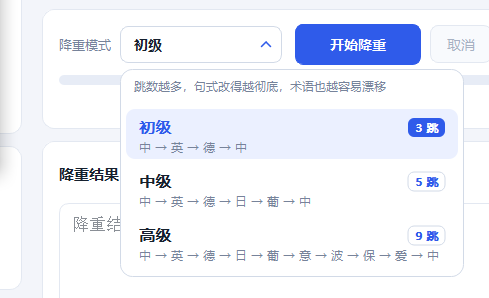

# 文章降重助手

基于百度翻译开放接口的**多语言回译**降重工具：把中文依次译成英、德、日等语言再译回中文，
利用不同语言的语序与表达差异打散原文句式，用于论文写作阶段的**表达润色**。

界面用 PyQt5 编写，支持长文分段、数字保护、结果缓存与 Word 导出。



> 当前版本 v2.0.0 · 下载见 [Releases](../../releases)

---

## 先说清楚它是什么

| 它做的事 | 它不做的事 |
|---|---|
| 改写句式，降低表达上的重复感 | ❌ 不保证通过任何查重系统 |
| 保留段落、空行与数字标号 | ❌ 不保留加粗、图表、公式排版 |
| 给出本地计算的「改动率」 | ❌ 不给出知网/维普的重复率 |
| 把结果导出成可排版的 Word | ❌ 不代替人工校对语义与术语 |

界面上的「改动率 / 保留率」是本地按编辑距离算出的**文本改动比例**，只衡量改写幅度。
**真实重复率只能在检测平台跑。**

## 效果参考

维普 AIGC 检测：


维普文章检测：



> 截图来自实际使用记录，仅代表特定文本在主客观条件下的结果，不作为效果承诺。

## 功能特点

- **长文可用**：按 UTF-8 字节分段（接口上限 6000 字节），中英日多语言断句，超长单句自动硬切
- **数字保护**：`3.14%`、`1200`、`[12]` 这类内容用占位符锁住，不会被中间语言改写成 `3,14 %` 或 `1.200`
- **结果缓存**：同一句子第二次翻译不消耗额度，调参数重跑几乎零成本
- **分段保留**：换行即分段，空行也原样保留，不需要「请勿分段」
- **不假死**：降重在后台线程执行，进度按「第 N/M 段 · 第 N/M 跳」显示，随时可取消
- **差异对照**：按句比对、差异标到字，删除内容带删除线
- **导出**：Word（宋体小四、首行缩进两字、1.5 倍行距）或 TXT，可选附上原文
- **密钥不落明文**：优先系统凭据管理器，其次 Windows DPAPI；两者都不可用时界面明示「未加密」
- **额度可控**：开始前预估请求数与字符消耗，超过 4 万字符二次确认

## 快速开始

### 方式一：直接运行 EXE（推荐给非开发者）

1. 从 [Releases](../../releases) 下载 `ArticleReducer-v2.0.0-win64.exe`（约 47 MB）
2. 双击运行，无需安装 Python
3. 首次启动比源码慢 1～2 秒（单文件包需要解压到临时目录），属正常现象

> Windows 10 / 11 64 位。若被杀毒软件拦截，请添加信任——单文件 PyInstaller 包常被误报。

### 方式二：从源码运行

```bash
pip install -r requirements.txt
python main.py
```

需要 Python 3.9+。`rapidfuzz`、`keyring`、`python-docx` 缺失时会自动降级，不影响主流程
（分别是：指标计算变慢、密钥退回 DPAPI、无法导出 Word）。

### 配置 API

1. 打开[百度翻译开放平台](https://fanyi-api.baidu.com/)注册账号
2. 进入管理控制台 → 注册成为开发者（个人）→ 开通「通用文本翻译 · 标准版」
3. 复制 **APPID** 与 **APPKEY**
4. 在软件左侧填入，点「保存配置」

配置存放在 `%APPDATA%\ArticleReducer\`，**下次启动自动加载，不需要再点「测试连接」**。
「测试」按钮只用于验证凭证是否有效，会真实调用一次接口（约 10 字符额度）。


## 使用步骤

1. 粘贴论文正文，或点「导入 TXT」选择文件。**换行即分段，空行会保留**
2. 选择降重模式：下拉里直接标出了跳数与语言链路，不用另外查表
3. 点「开始降重」（或 `Ctrl+Enter`），中途可点「取消」
4. 看「差异对比」页确认改动是否合理（`Ctrl+2` 切换页签）
   
5. 「复制」或「导出」（`Ctrl+E`）拿到结果

### 模式对照



| 模式 | 链路 | 额度倍数 | 适用场景 |
|---|---|---|---|
| 初级 | 中 → 英 → 德 → 中 | 3× | 术语多、要求稳，建议先用这个 |
| 中级 | 中 → 英 → 德 → 日 → 葡 → 中 | 5× | 句式需要更大幅度变化 |
| 高级 | 中 → 英 → 德 → 日 → 葡 → 意 → 波 → 保 → 爱 → 中 | 9× | 短文本、追求最大改动 |

## 额度说明

每跳都会重新翻译全文，消耗额度 ≈ **正文字数 × 跳数**。

| 文章字数 | 初级 3 跳 | 中级 5 跳 | 高级 9 跳 |
|---|---|---|---|
| 1000 字 | 3000 | 5000 | 9000 |
| 3000 字 | 9000 | 15000 | 27000 |
| 6000 字 | 18000 | 30000 | 54000 |

- 标准版每月免费 5 万字符，高级版（需实名）每月 100 万字符
- **命中缓存的部分不计费**：改一句话重跑，只有改动的段落会重新请求
- 免费版约 1 次/秒，3000 字初级模式大约 1～2 分钟

## 常见问题

**Q：重启后还要重新配置吗？**
不用。配置在用户目录，启动时自动加载并注入翻译器。

**Q：为什么「改动率」很高，查重却没过？**
两者不是一回事。改动率只统计字符层面的差异，查重系统还会看语义、结构、引用。
术语密集的论文，回译后表达变了但专业词仍是原样，查重系统照样能匹配。

**Q：数字会不会被改掉？**
不会。小数、百分数、四位以上整数、`[12]` 这类引用标号会被占位符锁住；
万一占位符在某一跳被翻译器弄丢，程序会丢弃该结果并用原文重新请求一次。

**Q：为什么中/高级模式有时语义会跑偏？**
跳数越多，中间语言的表达习惯叠加越多。9 跳后语义漂移是这类方案的固有代价。
建议：术语多的正文用初级，或降重后人工过一遍。

**Q：APPKEY 存在哪里？**
优先存进系统凭据管理器（`pip install keyring`）。没有 keyring 时用 Windows DPAPI 加密，
绑定当前用户账户。两者都没有时只做编码混淆，界面会明确提示「未加密」。

**Q：支持 PDF / 扫描件吗？**
不支持。请先转成可复制的文本再粘贴或导入 TXT。

**Q：旧版的 `config.json` 还要留着吗？**
不需要。首次启动会自动迁移到 `%APPDATA%\ArticleReducer\`，并把原文件改名为 `config.json.bak`。

## 项目结构

只有一个代码包 `app`，模块按职责命名，不再按层级分子目录。

```
main.py                 入口
build.spec              PyInstaller 打包配置
app/
    __init__.py         版本号与应用元信息
    paths.py            资源目录 / 用户数据目录（兼容单文件打包）
    settings.py         配置文件读写与旧版迁移
    secret_store.py     密钥存储（keyring → DPAPI → 混淆）
    segmenter.py        多语言断句、按字节分段、超长硬切
    protect.py          数字与引用标号占位符保护
    translator.py       百度翻译客户端（重试、限流自适应、保护、缓存）
    cache.py            翻译结果缓存（SQLite）
    pipeline.py         降重链路编排
    metrics.py          改动率 / 保留率
    export.py           TXT / Word 导出
    theme.py            设计令牌 + 全局 QSS
    widgets.py          卡片 / 分段控件 / 模式下拉 / 正文编辑框
    diff_view.py        句级 + 字级差异视图
    worker.py           后台线程（降重、连通性测试）
    main_window.py      主窗口
    resources/          图标（SVG + 多尺寸 ICO/PNG）
images/                 README 用截图
tools/                  图标生成脚本、exe 版本信息
```

依赖方向保持单向：`main_window → pipeline / translator / cache → segmenter / protect`，
业务模块不导入 PyQt，可以单独拿去做命令行批处理。

## 开发

```bash
# 重新生成图标（改了 icon.svg 之后）
python tools/make_icons.py

# 打包 exe → dist/ArticleReducer.exe
python -m PyInstaller build.spec --noconfirm --clean
```

界面分三段：左侧配置与步骤、中间「原文 / 运行条 / 结果」、右侧对照视图。
配色与字号集中在 `app/theme.py` 的 `COLORS` / `TYPE` 里，改一处即全局生效。

## 免责声明

本工具仅用于个人写作阶段的表达润色与语言学习。请遵守所在学校、期刊与平台的学术规范，
不要用它规避应有的原创性要求。使用产生的 API 费用与内容责任由使用者自行承担。

## 许可

MIT
